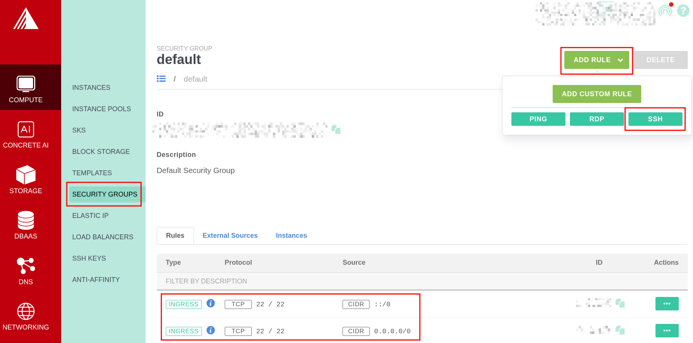
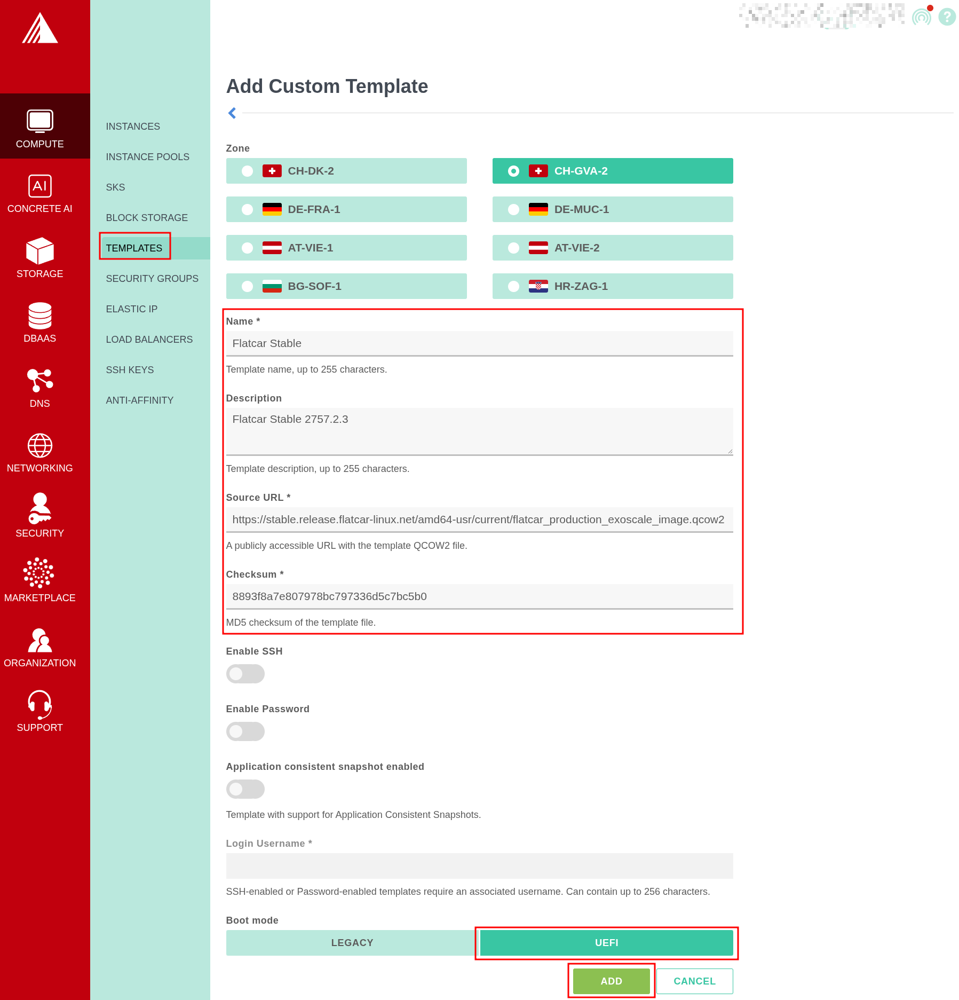
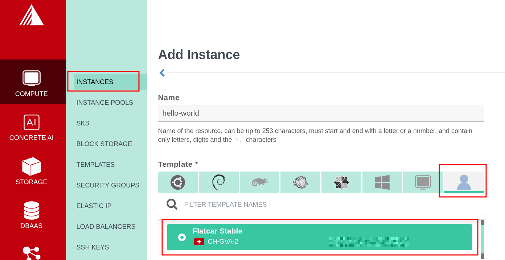
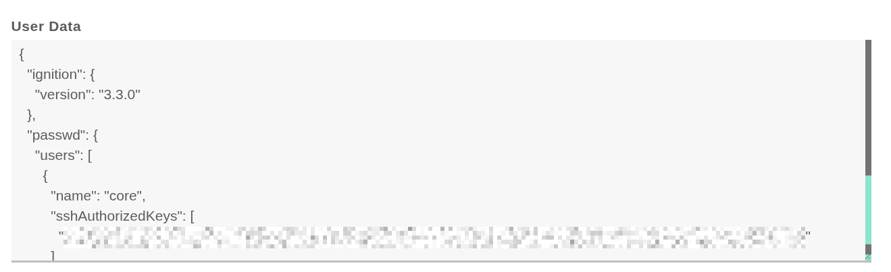
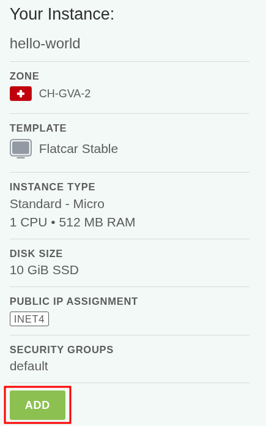
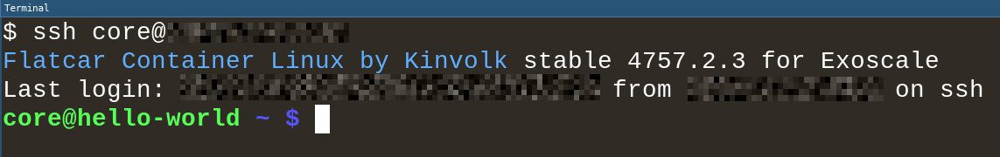

These instructions walk through importing a Flatcar Container Linux image and launching an instance on [Exoscale][exoscale] using either the [Exoscale Console (Web UI)][exo-console] or the [Exoscale CLI][exo-cli].

## Exoscale CLI (optional)

Installing the [Exoscale CLI][exo-cli] (`exo`) is optional; all setup steps can also be completed entirely through the [Exoscale Console (Web UI)][exo-console].

To use the CLI, follow the [official installation and configuration guide][exo-cli].

## Security groups

All Exoscale instances block inbound traffic by default. In this example we configure inbound SSH (TCP port 22) for IPv4 (`0.0.0.0/0`) and IPv6 (`::/0`) on the [security group][exo-sg], though the ports to open depend on your application.

<div id="exoscale-security-groups">
<ul class="nav nav-tabs">
  <li class="active"><a href="#sg-console" class="active" data-bs-toggle="tab">Exoscale Console (Web UI)</a></li>
  <li><a href="#sg-cli" data-bs-toggle="tab">Exoscale CLI</a></li>
</ul>
<div class="tab-content coreos-docs-image-table">
<div class="tab-pane active" id="sg-console">

In the Exoscale Console, navigate to **Compute > Security Groups**, select the `default` security group, and click **Add Rule > SSH** to allow inbound TCP port 22 for IPv4 (`0.0.0.0/0`) and IPv6 (`::/0`):



</div>
<div class="tab-pane" id="sg-cli">

Add rules to the `default` security group to allow SSH over IPv4 and IPv6:

```bash
exo compute security-group rule add default --network 0.0.0.0/0 --port 22
exo compute security-group rule add default --network ::/0 --port 22
```

</div>
</div>
</div>

## Custom templates

Flatcar Container Linux is not currently one of the official templates provided by Exoscale (tracked in [flatcar/Flatcar#2164][exo-template-issue]), so you must first register the Flatcar Exoscale `.qcow2` image for your desired [release channel][release-notes] (`stable`, `beta`, `alpha`, or `lts`) as an [Exoscale Custom Template][exo-custom-templates].

For the Stable channel, the image URL and MD5 checksum file are:

* Image URL: `https://stable.release.flatcar-linux.net/amd64-usr/current/flatcar_production_exoscale_image.qcow2`
* Checksums: `https://stable.release.flatcar-linux.net/amd64-usr/current/flatcar_production_exoscale_image.qcow2.DIGESTS`

> **Note:** Custom templates are zone-specific; the template's zone must match the zone where you intend to deploy your compute instances.

> **Note:** It is not necessary to enable SSH on the custom template because SSH keys are configured through Ignition.

> **Important:** Running instances [update automatically][update-strategies], but newly created instances will start from the image version registered in the custom template. If you regularly provision new instances, update your custom template as new releases are published.

<div id="exoscale-custom-templates">
<ul class="nav nav-tabs">
  <li class="active"><a href="#template-console" class="active" data-bs-toggle="tab">Exoscale Console (Web UI)</a></li>
  <li><a href="#template-cli" data-bs-toggle="tab">Exoscale CLI</a></li>
</ul>
<div class="tab-content coreos-docs-image-table">
<div class="tab-pane active" id="template-console">

1. Navigate to **Compute > Templates** and click **Add**.
2. Select your target **Zone** and enter a **Name** (for example, `Flatcar Stable`).
3. Enter the **Source URL** and the MD5 **Checksum** from the `.DIGESTS` file.
4. Leave **Enable SSH** and **Enable Password** disabled, set **Boot mode** to **UEFI**, and click **Add**.



</div>
<div class="tab-pane" id="template-cli">

Fetch the MD5 checksum for the Stable channel image and register the custom template:

```bash
ZONE=ch-gva-2 # Set to your target Exoscale zone
IMAGE_URL="https://stable.release.flatcar-linux.net/amd64-usr/current/flatcar_production_exoscale_image.qcow2"
MD5_SUM=$(curl -sL "${IMAGE_URL}.DIGESTS" | awk '/# MD5 HASH/{getline; print $1}')

exo compute instance-template register \
  "Flatcar Stable" \
  "${IMAGE_URL}" \
  "${MD5_SUM}" \
  --zone "${ZONE}" \
  --boot-mode uefi
```

</div>
</div>
</div>

## Butane Config

Flatcar Container Linux is configured on first boot using [Ignition][ignition]. Write a human-readable [Butane Config][butane-configs] and transpile it into an Ignition JSON file to pass as instance user data.

Create a minimal `config.bu` file that authorizes your SSH public key for the default `core` user:

```yaml
variant: flatcar
version: 1.0.0
passwd:
  users:
    - name: core
      ssh_authorized_keys:
        - ssh-ed25519 AAAAC3...
```

Transpile `config.bu` to an Ignition configuration (`config.ign`):

```bash
docker run --interactive --rm quay.io/coreos/butane:release \
  --pretty --strict < config.bu > config.ign
```

## Launching an instance

Create a new compute instance from the custom template and provide `config.ign` as the user data. In this example we will launch a `micro` instance with a `10 GiB` disk.

<div id="exoscale-launch">
<ul class="nav nav-tabs">
  <li class="active"><a href="#launch-console" class="active" data-bs-toggle="tab">Exoscale Console (Web UI)</a></li>
  <li><a href="#launch-cli" data-bs-toggle="tab">Exoscale CLI</a></li>
</ul>
<div class="tab-content coreos-docs-image-table">
<div class="tab-pane active" id="launch-console">

1. Navigate to **Compute > Instances** and click **Add**.
2. Enter a **Name** (for example, `hello-world`), select the **Custom Templates** tab under **Template**, and choose your Flatcar template:

   

3. Select the **Zone** matching your custom template, choose the **Standard - Micro** instance type, and set **Disk Size** to `10 GiB`.
4. Paste the contents of `config.ign` into the **User Data** field:

   

5. Review the instance settings and click **Add**:

   

</div>
<div class="tab-pane" id="launch-cli">

Create the instance with the CLI:

```bash
ZONE=ch-gva-2 # Must match the zone of the custom template

exo compute instance create hello-world \
  --zone "${ZONE}" \
  --template "Flatcar Stable" \
  --template-visibility private \
  --instance-type standard.micro \
  --disk-size 10 \
  --cloud-init config.ign
```

</div>
</div>
</div>

## SSH to your instance

Once the instance is running, connect using the `core` user and the instance's public IP address:

```bash
ssh core@<ip-address>
```



## Using Flatcar Container Linux

Now that you have a machine booted it is time to play around. Check out the [Flatcar Container Linux Quickstart][quickstart] guide or dig into [more specific topics][doc-index].

[butane-configs]: ../../fb-provision/butane/
[doc-index]: ../../
[exo-cli]: https://community.exoscale.com/tools/command-line-interface/
[exo-console]: https://portal.exoscale.com/
[exo-custom-templates]: https://community.exoscale.com/product/compute/instances/how-to/custom-templates/
[exo-sg]: https://community.exoscale.com/product/networking/security-group/
[exo-template-issue]: https://github.com/flatcar/Flatcar/issues/2164
[exoscale]: https://www.exoscale.com/
[ignition]: ../../fb-provision/ignition/
[quickstart]: ../../getting-started/quickstart/
[release-notes]: https://www.flatcar.org/releases/
[update-strategies]: ../../updates-releases/releases/update-strategies/
